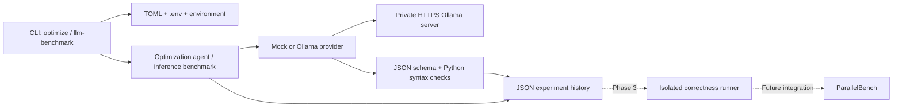

# HPC-AutoOptimizer

HPC-AutoOptimizer investigates LLM-guided optimization of computational Python programs using future correctness checks and real hardware feedback. Phase 2 adds remote Ollama inference, structured Python proposals, inference metrics, and reproducible model benchmarks. Proposals are hypotheses: this project does not yet establish behavioral equivalence or measure generated-program performance.

## Architecture

Python 3.11+; no runtime dependencies beyond the standard library.



| Module | Responsibility |
| --- | --- |
| `providers/base.py` | Provider abstraction, structured response, typed errors |
| `providers/mock.py` | Deterministic offline baseline and injectable response fixtures |
| `providers/ollama.py` | Model discovery, configurable requests, reasoning separation, timeouts |
| `config.py` | Validated TOML, .env, environment configuration |
| `models.py` | Strict proposal validation and Python AST parsing |
| `metrics.py` | Ollama timing and token-rate calculations |
| `agent.py` | Prompt construction and single optimization proposal workflow |
| `llm_benchmark.py` | Sequential inference-only measurements and statistics |
| `history.py` | Per-experiment JSON records and candidate artifacts |
| `reporting.py` | Markdown experiment summaries and compact optimization CLI output |
| `evaluation.py`, `benchmark.py` | Disabled isolated-evaluation contract and ParallelBench command planning |
| `cli.py` | Command-line entry points |

## Installation and offline smoke test

```bash
python3 -m venv .venv
source .venv/bin/activate
python -m pip install -e .
hpc-autooptimizer optimize examples/matrix_multiplication.py \
  --provider mock --target cpu --objective speed
```

The mock provider preserves source unchanged and invents no measurements. Without configuration, the default provider is mock. No Ollama, Tailscale, CUDA, or model download is needed for offline use or unit tests.

Without installation, use `PYTHONPATH=src python3 -m hpc_autooptimizer` in place of `hpc-autooptimizer`. Setuptools is required for package installation only.

## Local and remote Ollama

The intended client is the Ubuntu laptop (Ryzen 7 5800H / GTX 1650). Inference can run locally or on the Windows desktop (Ryzen 5 5500 / RTX 3060 Ti, 8 GB). The client only needs Python and network access; Ollama need not be installed on the laptop when using remote inference.

Primary model: `qwen3.5:9b-q4_K_M`. Secondary model: `qwen2.5-coder:7b`. Both use the same provider; model names never appear in optimization logic. Models must already be installed on the inference server. The client checks `/api/tags` and gives an installation hint if the requested name is absent. It never downloads models or installs packages suggested by a model.

For a local service, use `examples/ollama.toml`, which points to `http://127.0.0.1:11434`. For the remote service:

```bash
cp .env.example .env
# Edit HPC_OLLAMA_BASE_URL to your private Tailscale Serve HTTPS URL.
hpc-autooptimizer optimize examples/matrix_multiplication.py \
  --model qwen3.5:9b-q4_K_M --target cpu --objective speed
```

The example URL is a placeholder. `.env` and private `.env.*` files are excluded from Git. Keep actual host addresses in private configuration. Tailscale access, HTTPS termination, and Ollama service management remain external to this package. Do not expose Ollama publicly.

This deployment's Tailscale Serve route requires `Host: localhost:11434`; configure `HPC_OLLAMA_HOST_HEADER=localhost:11434`. That header applies to model discovery, generation, and model unloading. Leave it empty for direct local inference. It changes HTTP routing only: HTTPS certificate verification and the URL hostname used for TLS remain intact. No insecure SSL context is used. A 403 error points to the Host-header and private-network settings.

Generation uses the [Ollama generate API](https://docs.ollama.com/api/generate) with a JSON schema and non-streaming output. Reasoning returned in `thinking` is retained in the raw metadata, separately from the final `response` used for code. With `think=false`, an explicit unsupported-thinking HTTP 400 triggers one retry omitting that field; the fallback and effective settings are recorded. Unsupported `think=true` fails with a configuration hint. See Ollama's [thinking controls](https://docs.ollama.com/capabilities/thinking).

## Configuration

Precedence, lowest to highest: defaults, TOML, .env file, process environment, CLI overrides. The CLI loads `.env` from the working directory if present; `--env-file PATH` selects another file. The library's `ExperimentConfig.load()` only reads an environment file when explicitly passed one. `--config PATH` selects TOML. Relative paths resolve against the working directory.

| Environment variable | TOML key | Default |
| --- | --- | --- |
| `HPC_LLM_PROVIDER` | `provider` | `mock` |
| `HPC_OLLAMA_BASE_URL` | `base_url` | `http://127.0.0.1:11434` |
| `HPC_OLLAMA_MODEL` | `model` | `mock-v1`; explicitly select a model for Ollama |
| `HPC_OLLAMA_HOST_HEADER` | `host_header` | Unset |
| `HPC_OLLAMA_TIMEOUT` | `timeout_seconds` | `180` |
| `HPC_OLLAMA_KEEP_ALIVE` | `keep_alive` | `15m` |
| `HPC_OLLAMA_NUM_CTX` | `num_ctx` | `4096` |
| `HPC_OLLAMA_NUM_PREDICT` | `num_predict` | `2048` |
| `HPC_OLLAMA_TEMPERATURE` | `temperature` | `0.2` |
| `HPC_OLLAMA_THINK` | `think` | `false` |
| `HPC_HISTORY_DIR` | `history_dir` | `experiments` |

Environment `think` accepts `true`, `false`, or `null` (omit the request parameter and use the model default). TOML supports booleans; omit the key for the default `false`. Context and output-token limits must be positive integers; timeout must be positive and temperature nonnegative, both finite. Keep-alive accepts `0` or duration strings such as `30s`, `15m`, or `1h`. URLs must use HTTP(S) without embedded credentials; header values reject whitespace and control characters.

The .env reader accepts one supported `KEY=value` per line, whole-line comments, and optional surrounding single or double quotes. It does not run shell commands, expand variables, support `export`, or interpret inline comments. Unknown .env/TOML keys fail clearly; unrelated process environment variables are ignored.

Keep the 4096-token context on the 8 GB server unless deliberately changing it. Context is never increased automatically. `num_predict` caps generated output; a limit-truncated response fails rather than saving a partial candidate. Timeout is a socket-operation timeout, not an absolute wall-clock deadline. There are no automatic transport retries.

## Optimization usage

```bash
hpc-autooptimizer optimize examples/matrix_multiplication.py \
  --model qwen3.5:9b-q4_K_M --target cpu --objective speed \
  --function matrix_multiplication \
  --constraint "Preserve the function signature" \
  --constraint "Do not add dependencies"

hpc-autooptimizer optimize examples/matrix_multiplication.py \
  --model qwen2.5-coder:7b --target cpu --objective speed
```

Use `--provider ollama` or set it in configuration for real inference; `--model` alone does not change providers. Targets are `cpu`, `gpu`, and `general`; CPU numerical computing is the current focus. `--function` (alias `--target-function`) selects an existing function to focus on; the proposal still contains the complete file. Repeat `--constraint` for additional requirements. Prompts cover bottlenecks, complexity, allocations, optional NumPy/Numba use, numerical precision, assumptions, and risks. These are instructions to the model, not enforced semantic constraints.

Input existence and Python syntax are checked before inference. Output must contain exactly:

```json
{
  "optimized_code": "def square(x):\n    return x * x\n",
  "summary": "Preserve the numerical baseline",
  "changes": [],
  "expected_benefits": ["Unverified hypothesis"],
  "risks": ["Behavioral equivalence has not been tested"],
  "assumptions": ["Numeric inputs"]
}
```

Code and summary must be nonempty strings. Other fields are arrays of nonempty strings, which may be empty. Duplicate keys, extra fields, malformed JSON, Markdown fences, invalid Python syntax, incomplete envelopes, and output-limit stop reasons are rejected. The provider reads complete responses without silently truncating source. Successful source is saved as a separate `optimized.py` inside the experiment directory; original files are never replaced. Candidates are parsed with `ast.parse()`, never imported or executed.

Phase 1's positional-source CLI and five-field response schema remain readable; legacy responses normalize into the new schema. Direct agent calls without a source filename retain the `proposed_source.txt` artifact name.

Optimization commands print a compact report with the experiment ID, model, output path, inference time, token rate, and validation status. Add `--json` to retain the previous machine-readable JSON output. Missing inference metrics display as `Not available`.

## Inference benchmarks

With the remote .env configured, run these commands sequentially:

```bash
hpc-autooptimizer llm-benchmark --model qwen3.5:9b-q4_K_M --runs 5 --warmup
hpc-autooptimizer llm-benchmark --model qwen2.5-coder:7b --runs 5 --warmup
```

The command checks server availability and installed models, optionally makes one warm-up request, then sends the same numerical-computing prompt for every measured request. It saves prompt text/hash, inference settings, model metadata, individual raw responses, internal timings, and client-observed durations. Warm-up is stored separately and excluded from statistics. Structured generation and syntax validation match the optimization path.

It reports mean, median, minimum, maximum, and population standard deviation for client duration and available timing/token metrics. Output tokens/second is `eval_count / (eval_duration / 1e9)`; prompt tokens/second uses prompt counts and duration. Internal nanosecond values and converted seconds are both preserved. Missing or invalid metrics become null; zero duration produces no token-rate estimate. Mock benchmarks report client duration but leave inference token rates null.

One model is measured per invocation, requests run sequentially, and the selected model is explicitly unloaded afterward, including after request failure. Unload failures are recorded and printed. Avoid concurrent benchmark clients and ensure no other large model is resident on the 8 GB GPU; this client does not stop other workloads or impose server scheduling. Settings and prompts must match for a useful model comparison; review effective thinking settings and warm-up/cache effects as well. These measurements describe inference, not the performance of generated programs. No preliminary throughput number is a guaranteed result.

## Experiment persistence

```text
experiments/
  <optimization-uuid>/
    record.json       # version 2 metadata, prompt, raw response, metrics, status/errors
    proposal.json     # normalized validated proposal
    optimized.py      # complete untrusted candidate; never automatically run
    summary.md        # readable proposal, inference metrics, and validation status
  <llm-benchmark-uuid>/
    record.json       # settings, prompt, individual runs, warm-up, statistics
```

Optimization metadata includes UTC timestamp, source path/hash, generated path/hash, provider/model, objective, target/function/constraints, proposed changes, risks, assumptions, input/output token counts, internal and client timings, and separate schema/syntax/correctness/benchmark status. The agent's overall generation duration also includes model-discovery time; provider client timing isolates the generation request and any disclosed thinking fallback. Failed attempts retain errors and available raw responses without publishing a candidate file. Configuration/input errors happen before an experiment begins. Benchmark failures preserve partial results and excluded failed samples.

New records omit Ollama's `context` continuation-token array because it is unused by this workflow and obscures useful research metadata. Response text, model/settings, completion/error details, and all calculated metrics remain available. Each new optimization attempt also produces `summary.md`, including failures. It labels model suggestions and expected benefits as unverified, and marks correctness and performance as `Not evaluated`; Python syntax checks alone establish neither behavioral equivalence nor a speedup. Summaries reference the output file rather than embedding generated code or raw responses. Existing experiments are never rewritten or given summaries automatically.

Records are staged and published by directory rename with UUID collision rejection. Existing records are never migrated. This is a local filesystem store, not a database with distributed transactions or crash recovery. Storage failures can prevent logging. Full prompts and raw responses may contain source and reasoning; protect the experiments directory. The prompt retains the input source for reproducibility; proposal JSON is retained for structured inspection alongside the separate source artifact.

## ParallelBench and security limits

[ParallelBench](https://github.com/Pinkumi/ParallelBench) remains the independent engine for future generated-program benchmarking. Its adapter only plans built-in baseline CLI commands; it neither installs nor modifies ParallelBench. See [the integration design](docs/parallelbench.md). Inference benchmarking does not duplicate its numerical benchmarking engine.

Generated code remains untrusted. Schema and syntax checks establish neither safety nor equivalence. Correctness and program benchmark status remain `not_run`. There is no generated-code execution, CUDA compilation, iterative search, package installation, distributed execution, GUI, or automatic source replacement. Endpoint configuration contains no authentication-header support; use private network access and trusted inference services. Complete source is sent to the selected provider.

Phase 3 requires an enforced isolated runner with resource limits, wall-clock/process-tree termination, restricted filesystems, disabled networking, no host secrets, and independent correctness cases before any program benchmarking. Existing evaluation interfaces describe these policies but do not enforce them; execution methods fail explicitly. A plain subprocess with a timeout is insufficient.

## Development and roadmap

```bash
source .venv/bin/activate
PYTHONPATH=src python -m unittest discover -s tests -v
```

Unit tests mock HTTP and require no external services. Live inference checks are manual and optional; remote unavailability does not affect the suite.

1. Phase 1: provider abstraction, mock/Ollama inference, structured proposals, JSON history, CLI.
2. Phase 2: private remote Qwen inference, environment settings, model switching, Python proposal checks, inference metrics and benchmarks.
3. Phase 3: isolated correctness testing and measured program performance through a versioned ParallelBench boundary.
4. Later research: hardware feedback, iterative search, reproducible cross-model studies.
